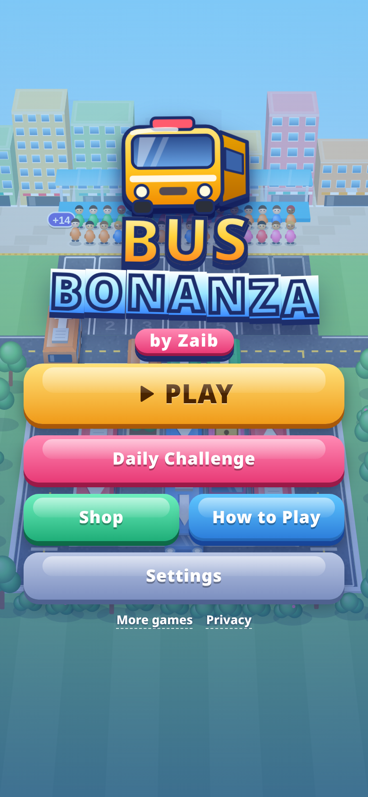
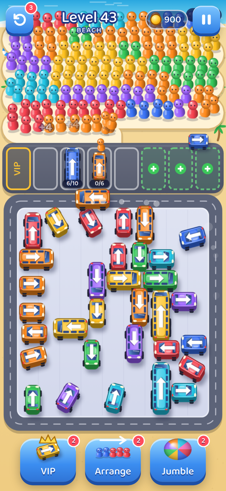

# Bus Bonanza 🚌

**A glossy traffic-jam passenger puzzle for mobile browsers. Game by Zaib.**

▶ **Play:** https://zaibgames.com/bus-bonanza/

A long, winding queue of passengers waits in colour runs. Below it, a packed lot holds cars, vans and buses parked at all kinds of angles, each with an arrow. Tap a vehicle and it drives out the way its arrow points, as long as nothing is in the way. Blocked vehicles bump and shake. A vehicle that gets out drives around the ring road into a free parking spot, and passengers of its colour walk over and board. Full vehicles leave and free their spot. If every spot fills up and nobody can board, you're out of space.

## Features
- **Look:** pseudo-3D canvas art. Vehicles have bevels, gloss, glass, wheels and soft shadows. Passengers are chunky, bob as they walk and hop when they board. You also get dust trails, sparkles, confetti and generated WebAudio sounds and music.
- **Vehicles:** cars hold 4, vans 6 and buses 10. They can face any angle (axis, 45°, 30°/60° and 15° steps).
- **Parking row:** 1 VIP spot, 4 open spots and 3 extra spots. You can open the extra spots with coins for a level. There are no ads.
- **Power-ups (with count badges and coin purchases):** *VIP* flies any vehicle to the VIP spot, *Arrange* sorts the queue, and *Jumble* reshuffles the lot's colours. Undo has its own count.
- **Hundreds of levels:** a seeded procedural generator builds each level by reverse construction, so every level is solvable by design. A solver checks levels 1–300 automatically (`bus-test/solv.js`). The difficulty curve rises smoothly with breather and spike levels. Themes rotate every 5 levels: beach, city, snow and night.
- **Screens:** a lose screen with undo/continue/retry, level select with stars, a tutorial, pause and settings.
- **Saves:** stored in localStorage and merged onto defaults. Old v1 saves are migrated (level, stars, coins, settings and boosters are kept), and damaged saves are handled without crashing.
- **Tech:** one self-contained HTML file. It is portrait-first and also supports landscape and desktop. Vehicle and queue sprites are cached, graphics quality adapts on slow devices, and it has its own PWA manifest and service worker.
